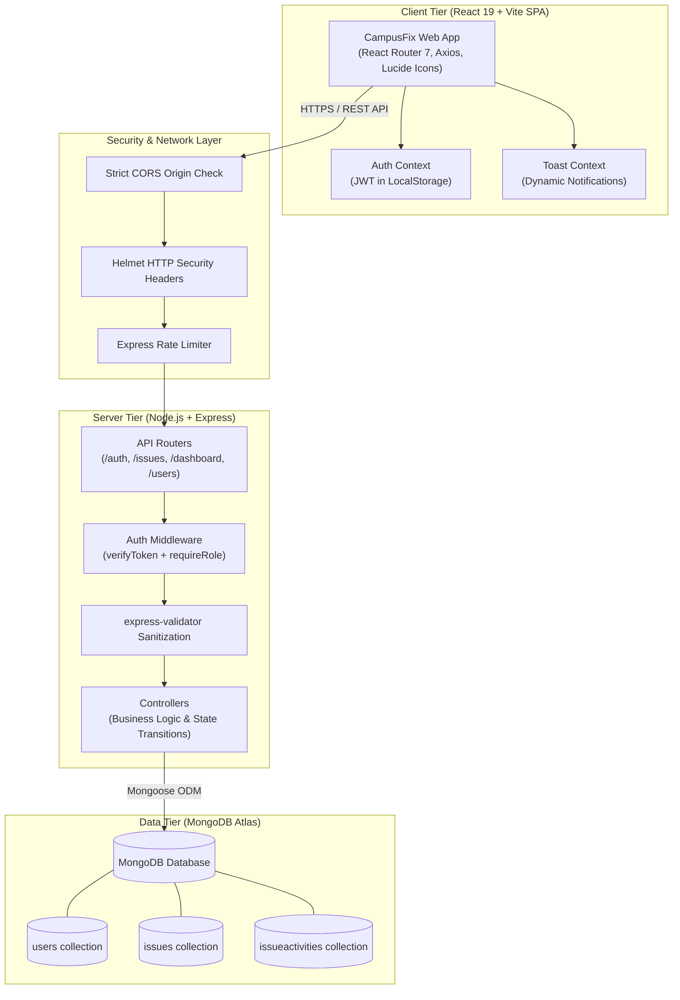
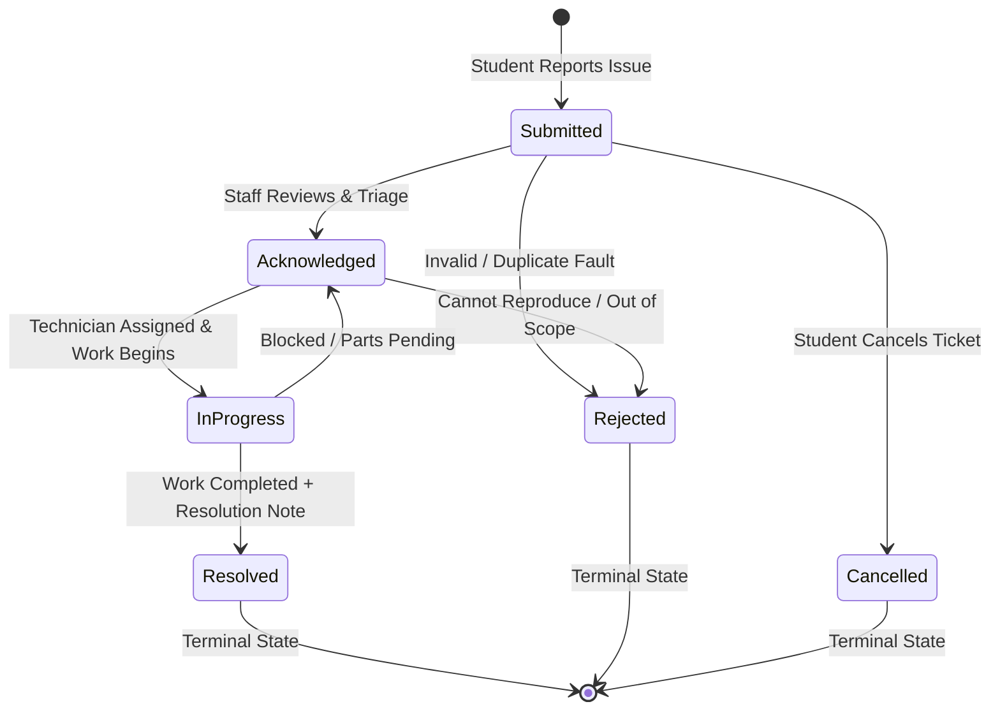

# CampusFix — Smart Campus Issue Tracker ⚡🏛️

[](https://nodejs.org/)
[](https://react.dev/)
[](https://expressjs.com/)
[](https://www.mongodb.com/)
[](LICENSE)
[](backend/tests/api.test.js)

**CampusFix** is a modern, production-grade **MERN stack** facility and maintenance tracking system engineered for university campuses. It replaces inefficient WhatsApp messages, paper logbooks, and fragmented emails with a centralized, transparent platform where students report infrastructure faults, maintenance technicians manage triage queues, and campus administrators track turnaround SLAs with real-time analytics.

---

## 🎥 Project Demo & Live Deployment

> **Walkthrough Video:** **[▶ Watch the CampusFix Demo](https://drive.google.com/drive/folders/1B5OgIJpwyMGwcWaAlbfqnUK45lrvp59i?usp=drive_link)**  
> *Demonstrates student fault reporting, executive operations analytics, administrative issue management, staff assignment, and maintenance progress tracking.*

### 🌐 Live Application Links
- **Frontend Client (Vercel):** [https://campufix.vercel.app](https://campufix.vercel.app)
- **Backend API Health Check (Render):** [https://campufix.onrender.com/api/health](https://campufix.onrender.com/api/health)
- **Source Code Repository:** [https://github.com/dhakshith414/campufix](https://github.com/dhakshith414/campufix)

---

## 📑 Table of Contents

1. [Project Demo & Live Deployment](#-project-demo--live-deployment)
2. [System Architecture](#-system-architecture)
3. [Key Features & Role-Based Access (RBAC)](#-key-features--role-based-access-rbac)
4. [Finite State Machine & Issue Lifecycle](#-finite-state-machine--issue-lifecycle)
5. [Database Schema & Models](#-database-schema--models)
6. [Security & Defensive Engineering](#-security--defensive-engineering)
7. [REST API Specification](#-rest-api-specification)
8. [Tech Stack](#-tech-stack)
9. [Local Development Setup](#-local-development-setup)
10. [Automated Test Suite](#-automated-test-suite)
11. [Production Deployment Guide](#-production-deployment-guide)
12. [Academic Project Report & Defense Q&A](#-academic-project-report--defense-qa)

---

## 🏛️ System Architecture

CampusFix is built as a decoupled Client-Server architecture with a clean separation of concerns:



---

## 👥 Key Features & Role-Based Access (RBAC)

The application enforces a strict three-tier Role-Based Access Control matrix across both API endpoints and client-side routes:

| Feature / Capability | Student | Staff / Technician | Administrator |
| :--- | :---: | :---: | :---: |
| Self-Registration & Login | ✅ | Login Only | Login Only |
| Report New Campus Fault | ✅ | ❌ | ❌ |
| Edit Own Ticket Details | ✅ *(Submitted status only)* | ❌ | ❌ |
| Cancel Own Ticket | ✅ *(Submitted status only)* | ❌ | ❌ |
| View Own Ticket History | ✅ *(Own tickets only)* | ✅ *(Assigned / All)* | ✅ *(All tickets)* |
| Real-time Audit Activity Timeline | ✅ *(Own tickets)* | ✅ | ✅ |
| Staff Triage Queue & Assignment | ❌ | ✅ | ✅ |
| Change Issue Status (Acknowledge / Progress / Resolve) | ❌ | ✅ | ✅ |
| Require Resolution Note upon Resolve | ❌ | ✅ | ✅ |
| Campus-wide Real-Time Analytics Dashboard | ❌ | ✅ *(Read-only)* | ✅ *(Full metrics)* |
| User Account Provisioning & Deactivation | ❌ | ❌ | ✅ |
| Promote / Demote User Roles | ❌ | ❌ | ✅ |

---

## 🔄 Finite State Machine & Issue Lifecycle

Issues transition through an enforced state machine to prevent race conditions or invalid resolutions:



### Transition Enforcement Rules:
1. **Submitted**: Initial state. Student may update details or cancel. Staff can acknowledge or reject.
2. **Acknowledged**: Issue recognized. Staff assignment can take place. Student can no longer modify details.
3. **In Progress**: Work underway. Technicians can reassign or move to Resolved.
4. **Resolved**: Terminal state. Requires a mandatory `resolutionNote` documenting what was repaired. Sets `resolvedAt` timestamp.
5. **Immutable Activity Log**: Every single transition automatically writes an unalterable audit log entry containing `actor`, `action`, `previousValue`, `newValue`, and `note`.

---

## 🗄️ Database Schema & Models

### 1. User Schema (`User.js`)
- `name`: String (2–100 chars, required)
- `email`: String (unique, validated regex format, lowercase)
- `passwordHash`: String (bcrypt, salt factor 12, hidden by default with `select: false`)
- `role`: Enum `['student', 'staff', 'admin']` (default: `'student'`)
- `department`: String (e.g., Computer Science, Electrical Maintenance)
- `isActive`: Boolean (default: `true`)
- *Timestamps*: `createdAt`, `updatedAt`

### 2. Issue Schema (`Issue.js`)
- `issueCode`: String (Unique human-readable identifier, e.g. `CF-2026-0001`, auto-generated via pre-save hook)
- `title`: String (5–150 chars, required)
- `description`: String (10–2000 chars, required)
- `category`: Enum `['Electrical', 'Plumbing & Water', 'Cleaning & Sanitation', 'Classroom Equipment', 'Internet & Wi-Fi', 'Furniture & Infrastructure', 'Safety', 'Other']`
- `location`:
  - `building`: String (required)
  - `room`: String
  - `additionalDetail`: String
- `priority`: Enum `['Low', 'Medium', 'High', 'Critical']` (default: `'Medium'`)
- `status`: Enum `['Submitted', 'Acknowledged', 'In Progress', 'Resolved', 'Rejected', 'Cancelled']`
- `reporter`: ObjectId -> `User` (required, indexed)
- `assignee`: ObjectId -> `User` (nullable, indexed)
- `resolutionNote`: String (max 1000 chars)
- `resolvedAt`: Date (nullable)
- *Compound Indexes*: `{ reporter: 1, createdAt: -1 }`, `{ status: 1, priority: 1, createdAt: -1 }`, `{ category: 1, status: 1 }`

### 3. IssueActivity Schema (`IssueActivity.js`)
- `issue`: ObjectId -> `Issue` (required, indexed)
- `actor`: ObjectId -> `User` (required)
- `action`: Enum `['created', 'status_changed', 'assigned', 'unassigned', 'reassigned', 'updated', 'resolved', 'rejected', 'cancelled', 'note_added']`
- `previousValue`: String
- `newValue`: String
- `note`: String (max 500 chars)
- `createdAt`: Date (immutable audit record, `updatedAt: false`)

---

## 🛡️ Security & Defensive Engineering

1. **Password Hashing**: Passwords are never stored in plaintext. Hashed with **bcryptjs** using 12 salt rounds.
2. **JWT Authentication**: Cryptographically signed JSON Web Tokens (`HS256`) containing `{ id, role }`, valid for 7 days.
3. **HTTP Header Protection**: Enforces security headers via **Helmet** (X-DNS-Prefetch-Control, X-Frame-Options, Strict-Transport-Security, X-Download-Options, X-Content-Type-Options).
4. **CORS Whitelisting**: Dynamic origin evaluation checking against `CLIENT_ORIGIN` environment variable.
5. **Rate Limiting**: Configured with `express-rate-limit` to prevent brute-force attacks on auth endpoints.
6. **Input Sanitization & Validation**: Request bodies pass through comprehensive `express-validator` chains before reaching business controllers.
7. **Role Tampering Prevention**: The public `/api/auth/register` endpoint hardcodes `role: 'student'`. Staff and admin accounts can **only** be created by an authenticated Administrator.
8. **No Secret Leaks**: Password hashes and internal Mongoose `__v` attributes are automatically stripped from all JSON responses.

---

## 📡 REST API Specification

### Authentication (`/api/auth`)
| Method | Endpoint | Access | Description |
| :--- | :--- | :--- | :--- |
| `POST` | `/api/auth/register` | Public | Register new student account |
| `POST` | `/api/auth/login` | Public | Authenticate user & receive JWT |
| `POST` | `/api/auth/logout` | Authenticated | Invalidate client session |
| `GET` | `/api/auth/me` | Authenticated | Retrieve current user profile |

### Issues (`/api/issues`)
| Method | Endpoint | Access | Description |
| :--- | :--- | :--- | :--- |
| `POST` | `/api/issues` | Student | Submit new maintenance ticket |
| `GET` | `/api/issues` | Authenticated | List issues with pagination & filtering |
| `GET` | `/api/issues/:id` | Authenticated | Get full details of an issue |
| `PATCH` | `/api/issues/:id` | Student (Submitted only) | Update issue title/description/location |
| `PATCH` | `/api/issues/:id/status` | Staff / Admin / Student (cancel) | Update issue status in state machine |
| `PATCH` | `/api/issues/:id/assignment` | Staff / Admin | Assign issue to staff technician |
| `GET` | `/api/issues/:id/activity` | Authenticated | Get timeline history of ticket |

### Analytics & Users (`/api/dashboard` & `/api/users`)
| Method | Endpoint | Access | Description |
| :--- | :--- | :--- | :--- |
| `GET` | `/api/dashboard/summary` | Staff / Admin | Aggregate metrics (status, priority, category) |
| `GET` | `/api/users` | Admin | List all registered users (paginated) |
| `POST` | `/api/users` | Admin | Provision new staff or admin user |
| `PATCH` | `/api/users/:id` | Admin | Deactivate/activate user or change role |
| `GET` | `/api/users/staff` | Staff / Admin | Get active staff list for ticket assignment |
| `GET` | `/api/health` | Public | Service health & MongoDB connection status |

---

## 💻 Tech Stack

- **Frontend**:
  - React 19 + Vite 8
  - React Router DOM 7 (Single Page Application routing)
  - Axios (with Bearer token interceptor and 401 automatic redirection)
  - Lucide React (Clean, modern iconography)
  - Vanilla CSS Design System (Custom design tokens, glassmorphism, responsive grid)
- **Backend**:
  - Node.js (v18+) & Express 4
  - Mongoose 8 (MongoDB ODM with schemas, hooks, compound indexes)
  - JSON Web Token (jsonwebtoken) & bcryptjs
  - Helmet, CORS, Morgan, Express-Validator
- **Testing & Quality Assurance**:
  - Jest & Supertest (End-to-end integration test suite)
  - Oxlint (High-performance code quality linter)

---

## 🚀 Local Development Setup

### 1. Prerequisites
- Node.js (v18.0.0 or higher)
- npm (v9.0.0 or higher)
- MongoDB instance (Local or MongoDB Atlas cluster URI)

### 2. Clone and Install Dependencies
```bash
# Clone the repository
git clone https://github.com/dhakshith414/campufix.git
cd campufix

# Install dependencies for both backend and frontend
npm run install:all
```

### 3. Configure Environment Variables

**Backend (`backend/.env`):**
```env
NODE_ENV=development
PORT=5000
MONGODB_URI=mongodb+srv://<username>:<password>@cluster.mongodb.net/campusfix?retryWrites=true&w=majority
JWT_SECRET=your_super_secret_jwt_key_at_least_32_characters_long
JWT_EXPIRES_IN=7d
CLIENT_ORIGIN=http://localhost:5173
```

**Frontend (`frontend/.env`):**
```env
VITE_API_BASE_URL=http://localhost:5000/api
```

### 4. Seed Demo Data
Populate the database with pre-configured users and realistic sample issues:
```bash
npm run seed
```

#### Demo Credentials:
| Role | Email | Password |
| :--- | :--- | :--- |
| **Administrator** | `admin@campusfix.demo` | `Admin@123` |
| **Staff / Technician** | `staff@campusfix.demo` | `Staff@123` |
| **Student** | `student@campusfix.demo` | `Student@123` |

### 5. Launch the Application
Open two terminal windows:

**Terminal 1 (Backend API):**
```bash
npm run dev:backend
# API will start on http://localhost:5000
# Health check available at http://localhost:5000/api/health
```

**Terminal 2 (Frontend Client):**
```bash
npm run dev:frontend
# Vite will launch frontend on http://localhost:5173
```

---

## 🧪 Automated Test Suite

CampusFix includes an extensive integration test suite verifying API authentication, validation rules, ticket lifecycle state machine transitions, audit history, dashboard analytics, and administrative authorization.

To run the test suite:
```bash
npm run test:backend
```

### Test Results Breakdown:
```text
PASS tests/api.test.js
  CampusFix API Integration Tests
    GET /api/health
      ✓ returns 200 with operational status and database connection state
    Auth Endpoints (/api/auth)
      ✓ rejects registration with missing required fields
      ✓ rejects registration with short password (< 6 chars)
      ✓ successfully registers a student user
      ✓ prevents registering with a duplicate email
      ✓ fails login with invalid password
      ✓ successfully logs in with correct credentials
      ✓ retrieves current user profile via GET /api/auth/me
      ✓ rejects /api/auth/me without token
    Staff & Admin Setup for Issue Testing
      ✓ creates staff and admin accounts directly in database
    Issue Management (/api/issues)
      ✓ rejects issue creation with missing fields or short title/description
      ✓ successfully creates an issue as a student
      ✓ student can view their created issue by ID
      ✓ student can edit their issue while in Submitted status
      ✓ staff can view the issue list and find the submitted issue
      ✓ staff can assign the issue to themselves
      ✓ rejects invalid status transition (Submitted -> Resolved directly)
      ✓ valid status transition: Submitted -> Acknowledged
      ✓ student cannot edit issue once status is past Submitted
      ✓ valid status transition: Acknowledged -> In Progress
      ✓ valid status transition: In Progress -> Resolved with resolution note
      ✓ checks audit trail / activity log for the issue
    Dashboard Endpoints (/api/dashboard)
      ✓ denies student access to staff/admin dashboard summary (403)
      ✓ allows staff access to dashboard summary with aggregate statistics
    User Administration (/api/users)
      ✓ denies non-admin access to user management
      ✓ allows admin to list users and create a new staff member
      ✓ allows staff to fetch staff list for ticket assignment dropdown

Test Suites: 1 passed, 1 total
Tests:       27 passed, 27 total
```

---

## 🌐 Production Deployment Guide

### Option A: Frontend on Vercel
1. Import your Git repository into [Vercel](https://vercel.com).
2. Set the **Root Directory** to `frontend`.
3. Set the Build Command to `npm run build` and Output Directory to `dist`.
4. Add the Environment Variable:
   - `VITE_API_BASE_URL`: `https://your-backend-api.onrender.com/api`
5. The included `frontend/vercel.json` ensures client-side routing works seamlessly with SPA rewrites.

### Option B: Backend on Render / Railway
1. Create a new **Web Service** pointing to your Git repository.
2. Set the **Root Directory** to `backend`.
3. Build Command: `npm install`
4. Start Command: `npm start`
5. Set Environment Variables:
   - `NODE_ENV`: `production`
   - `PORT`: `5000`
   - `MONGODB_URI`: `mongodb+srv://<user>:<password>@cluster.mongodb.net/campusfix?retryWrites=true&w=majority`
   - `JWT_SECRET`: `<generated-secure-random-64-character-string>`
   - `CLIENT_ORIGIN`: `https://your-frontend.vercel.app`

---

## 🎓 Academic Project Report & Defense Q&A

### 1. What problem does CampusFix solve?
Traditional campus facility management relies on physical registers, phone calls, or unmonitored messaging groups. These methods suffer from lack of accountability, no way to track resolution time, duplicate complaints for the same facility fault, and zero operational visibility for department heads. CampusFix introduces a structured digital workflow with SLA tracking, categorical aggregation, and role-based accountability.

### 2. Why MERN Stack?
- **MongoDB**: Schema flexibility accommodates varied issue parameters (locations, equipment details) while compound indexing ensures sub-millisecond query performance on status filters.
- **Express & Node.js**: Non-blocking asynchronous I/O handles concurrent student requests smoothly with low overhead.
- **React**: Component-driven architecture allows instant UI updates (e.g., dynamic status badge colors, interactive filter bars, toast alerts) without full page reloads.

### 3. How does CampusFix prevent unauthorized actions?
Security is implemented using defense-in-depth:
- Client-side routes are wrapped in `<ProtectedRoute>` checking both token validity and user role.
- Backend routes run `verifyToken` middleware, decoding and validating the cryptographic JWT signature.
- `requireRole(['staff', 'admin'])` guards administrative endpoints.
- Resource-level checks guarantee students cannot view or edit issues reported by other students.
- The state transition validator blocks arbitrary status jumps (e.g., jumping from `Submitted` directly to `Resolved`).

### 4. How is the database indexed for high performance?
Compound indexes are applied to the most common filter combinations:
- `{ reporter: 1, createdAt: -1 }`: Instant retrieval of a student's personal issue history.
- `{ status: 1, priority: 1, createdAt: -1 }`: Powers technician triage and priority sorting.
- `{ category: 1, status: 1 }`: Optimizes administrative dashboard category aggregations.

---

## 📄 License

This project is licensed under the MIT License — see the [LICENSE](LICENSE) file for details.
